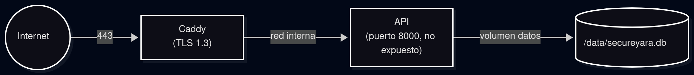

# SecureYara API

API REST que analiza con **reglas YARA** los archivos descargados en el navegador y devuelve un **veredicto explicado en español** (limpio, sospechoso o peligroso). Es el backend de la extensión de Chromium [SecureYara](#extensión-cliente).

> Proyecto de la asignatura Seguridad Informática, Universidad Politécnica de Chiapas.

## Contenido

1. [¿Qué hace?](#1-qué-hace)
2. [Cómo funciona](#2-cómo-funciona)
3. [Estructura del repositorio](#3-estructura-del-repositorio)
4. [Tecnologías](#4-tecnologías)
5. [Reglas YARA](#5-reglas-yara)
6. [Endpoints](#6-endpoints)
7. [Escaneo de archivos ZIP](#7-escaneo-de-archivos-zip)
8. [Caché e historial (SQLite)](#8-caché-e-historial-sqlite)
9. [Configuración](#9-configuración)
10. [Seguridad de la API](#10-seguridad-de-la-api)
11. [Ejecución en local](#11-ejecución-en-local)
12. [Despliegue con Docker](#12-despliegue-con-docker)
13. [Pruebas](#13-pruebas)
14. [Limitaciones](#14-limitaciones)
15. [Créditos y licencia](#15-créditos-y-licencia)

---

## 1. ¿Qué hace?

Los archivos descargados desde la web son un vector habitual de entrega de malware: documentos con macros, instaladores falsos, ejecutables disfrazados. SecureYara analiza cada archivo **en el momento de la descarga**, antes de que el usuario lo abra.

La API recibe el archivo junto con el **contexto de la descarga** (nombre, extensión, tipo MIME y dominio de origen), lo analiza con YARA y responde con:

- un **veredicto**: `limpio`, `sospechoso` o `peligroso`;
- la **severidad** y la **categoría** de la amenaza;
- las **coincidencias** encontradas, cada una con un título, una explicación y una recomendación en español.

El diferenciador del proyecto es el **escaneo con contexto**: además del contenido, las reglas reciben el nombre, la extensión, el MIME y el origen, lo que permite detectar engaños como una doble extensión (`factura.pdf.exe`), un tipo que no coincide con la extensión o un ejecutable descargado desde una dirección IP. Los archivos `.zip` se inspeccionan por dentro (una capa).

Además, la API guarda un **historial** y una **caché por hash** en SQLite, y expone estadísticas para el popup de la extensión.

## 2. Cómo funciona

```
Extensión (Chromium)                         API (FastAPI)
─────────────────────                        ─────────────────────────────────────
1. Pausa la descarga y
   obtiene el archivo
2. Calcula el SHA-256
3. POST /verdicts/lookup  ───────────────▶   Busca en la caché (hash + reglas + contexto)
                          ◀───────────────   200 con el resultado guardado, o 404
4. Si no hay resultado:
   POST /scan (multipart) ───────────────▶   Valida la entrada y los límites
                                             Verifica que el SHA-256 coincida
                                             Ejecuta las reglas YARA con el contexto
                                             (abre el ZIP si corresponde)
                                             Calcula el veredicto y lo guarda
                          ◀───────────────   JSON con el veredicto y las coincidencias
5. Muestra el aviso o reanuda
   la descarga
```

## 3. Estructura del repositorio

```
Security-Yara-Api/
├── .gitignore
├── samples/                     # muestras de prueba (ignorada por git)
└── api/
    ├── src/
    │   └── api/
    │       ├── __init__.py
    │       ├── main.py          # aplicación FastAPI: endpoints, middleware, seguridad
    │       ├── motor.py         # motor de escaneo: carga de reglas, severidad, categorías, ZIP
    │       ├── db.py            # modelo Scan, caché, historial y estadísticas (SQLAlchemy)
    │       └── config.py        # configuración por variables de entorno
    ├── rules/
    │   ├── vendor/              # reglas del repositorio compartido Yara-Rules
    │   │   ├── malware/
    │   │   ├── maldocs/
    │   │   ├── exploit_kits/
    │   │   └── cve_rules/
    │   └── custom/              # reglas propias (EICAR y reglas de contexto)
    ├── scripts/                 # herramientas de apoyo para pruebas
    │   └── servidor_muestras.py # sirve ../samples para descargarlas desde el navegador
    ├── tests/                   # pruebas
    ├── Dockerfile               # imagen de la API (multi-etapa, usuario sin privilegios)
    ├── docker-compose.yml       # servicios: api + caddy (HTTPS)
    ├── Caddyfile                # proxy inverso, certificado y límite de cuerpo
    ├── .dockerignore
    ├── .env.example             # plantilla de variables de entorno (sin secretos)
    ├── pyproject.toml           # dependencias y metadatos del proyecto
    ├── uv.lock                  # versiones exactas de las dependencias
    └── .python-version
```

## 4. Tecnologías

| Capa | Tecnología |
|---|---|
| Lenguaje | Python 3.14 |
| Framework web | FastAPI, servido con uvicorn |
| Motor de detección | yara-python (reglas YARA) |
| Base de datos | SQLite, con SQLAlchemy |
| Gestor de dependencias | uv (`pyproject.toml` y `uv.lock`) |
| Contenedores | Docker y Docker Compose |
| Proxy y HTTPS | Caddy, con certificados de Let's Encrypt |
| Infraestructura | AWS EC2 (Ubuntu 24.04), Elastic IP y dominio DuckDNS |
| Análisis estático | CodeQL, bandit y pip-audit |

## 5. Reglas YARA

### 5.1 Origen de las reglas

Las reglas provienen de dos fuentes:

- **Repositorio compartido [Yara-Rules/rules](https://github.com/Yara-Rules/rules)**, copiado en `rules/vendor/`. Se usan **cuatro familias**, orientadas a lo que llega por descargas web:

  | Carpeta | Contenido |
  |---|---|
  | `malware/` | Firmas de familias de malware conocidas |
  | `maldocs/` | Documentos maliciosos: macros, objetos OLE incrustados, formatos de Office y RTF |
  | `exploit_kits/` | Kits de exploits que atacan al navegador y a sus complementos |
  | `cve_rules/` | Patrones asociados a vulnerabilidades concretas (CVE) |

- **Reglas propias**, en `rules/custom/`:
  - **EICAR**: detecta el archivo de prueba estándar de antivirus (inofensivo). Sirve para verificar que el sistema funciona.
  - **Reglas de contexto**: usan variables externas que la API llena con los datos de la descarga. Entre ellas, `Contexto_DobleExtension` (nombres como `factura.pdf.exe`), `Contexto_EjecutableDesdeIP` (ejecutable descargado desde una dirección IP) y una que detecta un tipo MIME que no coincide con la extensión.

Cada regla de terceros conserva su licencia original. Consulta el repositorio de origen antes de redistribuirlas. Para contar las reglas por familia (conteo aproximado):

```bash
for d in malware maldocs exploit_kits cve_rules; do
  echo "$d: $(grep -rhE '^\s*(private |global )*rule ' rules/vendor/$d | wc -l)"
done
```

### 5.2 Variables externas (contexto de la descarga)

Al compilar, el motor declara cuatro variables externas. En cada escaneo la API les asigna el valor de la descarga:

| Variable | Contenido |
|---|---|
| `filename` | Nombre del archivo, sin ruta y con el sufijo ` (n)` de Chrome normalizado |
| `extension` | Extensión en minúsculas y sin el punto |
| `mime` | Tipo MIME informado por el navegador |
| `source_domain` | Dominio (o IP) de origen de la descarga |

### 5.3 Carga y versión de las reglas

- Cada archivo `.yar` o `.yara` bajo `rules/` se compila con un *namespace* derivado de su ruta relativa (`vendor/maldocs/Algo.yar` se convierte en `vendor_maldocs_Algo_yar`). El prefijo del namespace determina la categoría.
- Las reglas se compilan **una sola vez al arrancar** el servicio (así una regla rota hace fallar el arranque y no un escaneo).
- La **versión de las reglas** (`rules_version`) son los primeros 7 caracteres del SHA-256 calculado sobre el contenido de todos los archivos de reglas. Si se modifica, agrega o quita una regla, la versión cambia y la caché anterior deja de aplicarse.

### 5.4 Categorías

La categoría de cada coincidencia sale de la carpeta de la regla:

| Carpeta (prefijo del namespace) | Categoría | Nombre mostrado |
|---|---|---|
| `vendor/malware` | `familia_malware` | Familia de Malware |
| `vendor/cve_rules` | `exploit_cve` | Exploit CVE |
| `vendor/exploit_kits` | `kit_exploits` | Kit de exploits |
| `vendor/maldocs` | `documento_malicioso` | Doc. malicioso |
| `custom/contexto` | `engano_contexto` | Engaño de contexto |
| `custom/eicar` | `prueba` | Archivo de prueba |
| cualquier otra | `otra` | Otra detección |

Excepción: si el **nombre de la regla contiene «cve»**, se clasifica como `exploit_cve` aunque esté en otra carpeta, y el código (por ejemplo, `CVE-2017-0199`) se agrega a la explicación.

### 5.5 Severidad: cómo se decide que algo es «altamente malicioso»

Las reglas de la comunidad no se escriben igual: unas traen `severity`, otras `weight` o `score`, y muchas nada. El motor las unifica en tres niveles (`low`, `medium`, `high`) probando estos criterios **en orden**; se queda con el primero que aplica:

1. **Ajuste manual por nombre de regla.** `RTFFILE` y `Word_2007_XML_Flat_OPC` son `low` (identifican un formato de archivo, no una amenaza); `BlackHole_v2` es `high`.
2. **Metadato `severity`** de la regla, si vale `low`, `medium` o `high`.
3. **Metadato `weight`** numérico: `low` (es un indicio heurístico que no debe bastar por sí solo).
4. **El nombre de la regla contiene «cve»**: `high`.
5. **Metadato `score`** numérico: `high` desde 70, `medium` por debajo. El corte de 70 es una decisión de este proyecto, no un estándar.
6. **Valor por defecto de la familia:** `high` para `malware`, `cve_rules` y `exploit_kits`; `medium` para `maldocs`.
7. **Cualquier otro caso:** `medium`.

Las reglas propias declaran su severidad en su `meta`.

### 5.6 Veredicto

- Las coincidencias `low` **se guardan y se muestran, pero no cuentan** para el veredicto.
- Sin coincidencias que no sean `low`: **`limpio`**.
- Si la coincidencia más grave es `medium`: **`sospechoso`**.
- Si la coincidencia más grave es `high`: **`peligroso`**.
- La **categoría principal** es la de la coincidencia más grave. En caso de empate se elige por esta prioridad: familia de malware, exploit CVE, kit de exploits, documento malicioso, engaño de contexto, prueba y otra.

Criterio de diseño: **cuanto más específica es una firma, mayor severidad; cuanto más heurístico es el indicio, menor.** Las familias `malware`, `cve_rules` y `exploit_kits` son firmas muy concretas, mientras que macros u objetos OLE de `maldocs` también aparecen en documentos legítimos.

### 5.7 Cómo agregar o cambiar una regla

1. Copia el archivo `.yar` a la carpeta de su familia en `rules/vendor/` (o a `rules/custom/`).
2. Si necesitas fijar su severidad, agrégala en el `meta` de la regla (`severity = "high"`) o en `SEVERIDAD_POR_REGLA` de `motor.py`.
3. Reinicia el servicio: las reglas se recompilan y `rules_version` cambia, de modo que la caché previa deja de aplicarse.

## 6. Endpoints

| Método | Ruta | Descripción | Autenticación |
|---|---|---|---|
| `GET` | `/health` | Estado del servicio | No |
| `POST` | `/scan` | Analiza un archivo y devuelve el veredicto | Sí |
| `POST` | `/verdicts/lookup` | Consulta la caché | Sí |
| `GET` | `/stats` | Estadísticas para el popup | Sí |

La autenticación es la cabecera `X-API-Key`. Si la variable `API_KEY` está vacía (solo desarrollo), no se exige.

### `POST /scan`

Cuerpo `multipart/form-data`:

| Campo | Obligatorio | Descripción |
|---|---|---|
| `file` | Sí | El archivo (hasta 25 MB) |
| `sha256` | Sí | Hash del archivo; la API lo recalcula y debe coincidir |
| `filename` | Sí | Nombre del archivo, sin ruta (máx. 255 caracteres) |
| `extension` | No | Extensión (máx. 32) |
| `mime` | No | Tipo MIME (máx. 128) |
| `source_domain` | No | Dominio de origen (máx. 255) |
| `scan_mode` | No | `principal` (por defecto) o `degradado` |

```bash
HASH=$(sha256sum archivo.zip | cut -d' ' -f1)
curl -s -X POST "$API_URL/scan" -H "X-API-Key: $API_KEY" \
  -F file=@archivo.zip -F sha256=$HASH -F filename=archivo.zip \
  -F extension=zip -F mime=application/zip
```

Respuesta (ejemplo):

```json
{
  "verdict": "peligroso",
  "severity": "high",
  "matches": [
    {
      "rule": "EICAR_Prueba",
      "title_es": "...",
      "explanation_es": "... (dentro del ZIP: carpeta/prueba.txt)",
      "recommendation_es": "...",
      "severity": "high",
      "category": "prueba",
      "description": "...",
      "archivo_interno": "carpeta/prueba.txt"
    }
  ],
  "rules_version": "d679d5c",
  "main_category": "prueba"
}
```

`archivo_interno` aparece solo cuando la coincidencia viene de un archivo dentro de un ZIP.

### `POST /verdicts/lookup`

Consulta si ya existe un resultado guardado. Los datos viajan en el cuerpo JSON y no en la dirección, para que el hash, el nombre y el dominio no queden en los registros de acceso:

```json
{
  "sha256": "<64 caracteres hexadecimales>",
  "filename": "archivo.zip",
  "mime": "application/zip",
  "source_domain": "sitio.example",
  "scan_mode": "principal"
}
```

Responde `200` con el mismo JSON que `/scan`, o `404` si no hay un veredicto guardado para esos datos.

### `GET /stats`

Totales y categorías para el popup de la extensión (ejemplo):

```json
{
  "total": 24,
  "sospechosos": 7,
  "peligrosos": 5,
  "categorias": [
    {
      "categoria": "engano_contexto",
      "cantidad": 5,
      "archivos": [
        { "filename": "...", "severity": "high", "fecha": "2026-11-23T08:00:00+00:00", "veces": 2 }
      ],
      "nombre_es": "...",
      "explicacion_es": "...",
      "recomendacion_es": "..."
    }
  ]
}
```

Devuelve como máximo las 5 categorías con más detecciones (solo veredictos sospechoso y peligroso) y, por cada una, los 3 archivos más recientes distintos.

### Códigos de error

| Código | Causa |
|---|---|
| `400` | Nombre de archivo con ruta, o `sha256` que no coincide con el archivo |
| `401` | Clave de API ausente o inválida |
| `404` | Sin veredicto guardado (`/verdicts/lookup`) |
| `413` | Archivo o cuerpo de la petición demasiado grande |
| `422` | Campo que excede su longitud máxima o con formato inválido |
| `500` | Error interno (el detalle solo queda en el registro del servidor) |
| `503` | Servidor ocupado: se agotó la espera de turno de escaneo |
| `504` | Tiempo máximo de escaneo agotado |

## 7. Escaneo de archivos ZIP

Los ZIP se inspeccionan por dentro, **en memoria y sin escribir nada en disco**:

1. Se escanea el ZIP completo, como cualquier otro archivo.
2. Si el archivo llega como `.zip` o `application/zip` **y** empieza con la firma ZIP, se abre y cada archivo interno se escanea con su propio nombre y extensión como contexto (así, `factura.pdf.exe` dentro de un ZIP activa la regla de doble extensión).
3. Las coincidencias de todos los archivos se combinan: el veredicto es el más grave, y cada coincidencia indica su `archivo_interno`.

Solo se abre **una capa**, con estos límites contra bombas de compresión:

| Límite | Valor |
|---|---|
| Archivos analizados por ZIP | 50 |
| Tamaño de cada archivo interno | 25 MB |
| Total descomprimido | 50 MB |
| Tiempo | Compartido con `SCAN_TIMEOUT_S` |

No se abren los ZIP **anidados** ni los **cifrados**. Los archivos como `.docx`, `.xlsx` o `.jar`, que también son ZIP por dentro, se escanean como un bloque y no se abren.

## 8. Caché e historial (SQLite)

### 8.1 Caché por hash

Antes de subir un archivo, la extensión consulta `POST /verdicts/lookup`. Un resultado guardado solo se reutiliza si coincide **todo** lo siguiente:

| Componente de la clave | Por qué |
|---|---|
| `sha256` | Es el mismo contenido |
| `rules_version` | Las reglas no han cambiado desde el escaneo |
| `filename` (normalizado) | El nombre cambia el resultado de las reglas de contexto |
| `mime` | Ídem |
| `source_domain` | Ídem (por ejemplo, la regla de ejecutable desde una IP lo usa) |

Por eso el mismo archivo descargado desde otro dominio se vuelve a escanear. El nombre se normaliza quitando el sufijo ` (n)` que Chrome agrega a las descargas repetidas (`factura (1).pdf` equivale a `factura.pdf`).

Cuando hay un acierto, la API devuelve el resultado guardado y **registra una nueva fila** con `from_cache = true`, de modo que el historial refleje cada descarga, no solo los escaneos nuevos.

### 8.2 Base de datos

- **Motor:** SQLite, un archivo (`secureyara.db` en local; `/data/secureyara.db` en Docker, dentro de un volumen).
- **Acceso:** SQLAlchemy, con consultas parametrizadas.
- **Elección:** para un solo servidor y poco volumen, SQLite evita administrar un servicio aparte y facilita el respaldo. La conexión se define por `DATABASE_URL`, así que migrar a PostgreSQL requiere cambiar esa variable.

Tabla `scans`:

| Columna | Descripción |
|---|---|
| `id` | Identificador |
| `created_at` | Fecha y hora (UTC) |
| `sha256` | Hash del archivo (con índice) |
| `filename`, `extension`, `mime`, `source_domain` | Contexto de la descarga |
| `size_bytes` | Tamaño del archivo |
| `verdict`, `severity`, `main_category` | Resultado del análisis |
| `matches_json` | Coincidencias en JSON (nunca el contenido del archivo) |
| `rules_version` | Versión de las reglas con las que se escaneó |
| `scan_mode` | `principal` o `degradado` |
| `from_cache` | Si el resultado salió de la caché |

El archivo en sí **nunca se guarda**: solo sus metadatos y el resultado.

### 8.3 Estadísticas

`GET /stats` agrupa la tabla por veredicto y por categoría (solo sospechosos y peligrosos) y toma los últimos archivos distintos de cada categoría. Cuenta registros, es decir, cada descarga escaneada o resuelta desde la caché.

## 9. Configuración

Toda la configuración se lee de variables de entorno en `config.py`. Copia `.env.example` a `.env` y ajusta (el `.env` no se sube a git):

| Variable | Valor por defecto | Descripción |
|---|---|---|
| `DATABASE_URL` | `sqlite:///secureyara.db` | Conexión a la base de datos |
| `MAX_UPLOAD_BYTES` | `26214400` (25 MiB) | Tamaño máximo del archivo |
| `SCAN_TIMEOUT_S` | `10` | Tiempo máximo de análisis de YARA |
| `MAX_CONCURRENT_SCANS` | `2` | Escaneos simultáneos |
| `SCAN_QUEUE_WAIT_S` | `5` | Espera de turno antes de responder 503 |
| `API_KEY` | vacía | Clave de la API (vacía = sin clave, solo desarrollo) |
| `ENABLE_DOCS` | `false` | Activa `/docs`, `/redoc` y `/openapi.json` |

Los límites de longitud de los campos y los del ZIP son constantes de `config.py`.

> Al ejecutar con `uv run`, usa `--env-file .env`; sin esa opción se ignoran los valores del archivo y se aplican los de la tabla.

## 10. Seguridad de la API

La API recibe archivos potencialmente hostiles, así que se acota el propio servicio:

| Riesgo | Control |
|---|---|
| Entradas no confiables | Longitud máxima por campo (`422`), nombres sin ruta (`400`), SHA-256 recalculado y comparado (`400`), `scan_mode` con lista cerrada |
| Abuso de recursos | Límite de 25 MB en dos capas (middleware por `Content-Length` y lectura acotada, `413`) y en el proxy; tiempo máximo de YARA (`504`); 2 escaneos simultáneos con cola de 5 s (`503`); un solo worker |
| Acceso | Clave `X-API-Key` comparada en tiempo constante (`401`); solo `/health` es público |
| Cifrado en tránsito | HTTPS con TLS 1.3 (Caddy); HTTP redirige a HTTPS (`308`) |
| Inyección | Consultas parametrizadas; el contenido se analiza en memoria y no se ejecuta |
| Configuración | Documentación apagada por defecto, sin CORS abierto, secretos en variables de entorno, contenedor sin root, solo los puertos 80 y 443 públicos y SSH restringido a la IP del administrador |
| Privacidad | Consulta de caché por POST; el contenido de los archivos nunca se registra; los errores inesperados devuelven un mensaje genérico y su detalle queda solo en el servidor |
| Dependencias | `uv.lock` fijo y auditoría con pip-audit |

**Limitaciones de seguridad conocidas:** la clave compartida empaquetada en la extensión puede extraerse (frena el uso casual, no sustituye una autenticación por usuario); el límite por `Content-Length` no cubre cuerpos enviados en trozos (lo cubre el proxy); el historial guarda nombre, dominio y hash de cada descarga, equivalente a un historial de navegación.

## 11. Ejecución en local

Requisitos: Python 3.14 y [uv](https://docs.astral.sh/uv/).

```bash
git clone https://github.com/Silverz34/Security-Yara-Api.git
cd Security-Yara-Api/api
cp .env.example .env
uv sync
uv run --env-file .env fastapi dev src/api/main.py
```

La API queda en `http://127.0.0.1:8000`. Con `ENABLE_DOCS=true` en el `.env`, la documentación interactiva está en `/docs`.

Comprobación rápida:

```bash
curl -s http://127.0.0.1:8000/health
# {"status":"ok"}
```

Para probar con el navegador, `scripts/servidor_muestras.py` sirve la carpeta `samples/` en `http://127.0.0.1:9000` (como descarga) y ofrece `/lento?seg=N`, que entrega 10 MB de forma lenta para probar descargas largas:

```bash
uv run python scripts/servidor_muestras.py
```

## 12. Despliegue con Docker

### 12.1 Componentes

| Archivo | Función |
|---|---|
| `Dockerfile` | Construcción en dos etapas con `python:3.14-slim`: la primera instala las dependencias con `uv sync --frozen --no-dev` (con herramientas de compilación para yara-python) y la segunda solo copia el entorno, el código y las reglas. Corre como usuario **sin privilegios** (uid 10001) y arranca `uvicorn` con **un worker**. |
| `docker-compose.yml` | Dos servicios: `api` (no publica puertos, solo los expone a la red interna) y `caddy` (publica 80 y 443). Tres volúmenes: `datos` (la base SQLite en `/data`), `caddy_data` (certificados) y `caddy_config`. Ambos servicios tienen `restart: unless-stopped`. |
| `Caddyfile` | Define el dominio, obtiene el certificado de Let's Encrypt, redirige HTTP a HTTPS, limita el cuerpo de las peticiones (27 MB) y reenvía a `api:8000`. |




### 12.2 Despliegue de referencia (AWS)

1. **EC2:** instancia Ubuntu 24.04 (`t3.medium`, 20 GB) con un grupo de seguridad que permite el puerto 22 solo desde la IP del administrador
2. **Elastic IP** asociada a la instancia y un **dominio** (por ejemplo, de DuckDNS) que apunta a ella. Edita el nombre del sitio en el `Caddyfile`.
3. **Docker:** `curl -fsSL https://get.docker.com | sudo sh` y agrega tu usuario al grupo `docker`.
4. **Código:**

   ```bash
   git clone https://github.com/Silverz34/Security-Yara-Api.git
   cd Security-Yara-Api/api
   ```


## 13. Pruebas

### Funcionales (con `curl`)

| Prueba | Resultado esperado |
|---|---|
| ZIP con EICAR comprimido | `peligroso`, regla `EICAR_Prueba` con `archivo_interno` |
| ZIP con `factura.pdf.exe` | `sospechoso`, `Contexto_DobleExtension` |
| ZIP con un archivo de texto | `limpio` |
| ZIP con un archivo de 60 MB descomprimido | `limpio`, el archivo se omite por el límite |
| Campo de 300 caracteres | `422` |
| Cuerpo mayor al límite | `413` |
| Sin clave o con clave incorrecta | `401` |
| `/docs` con `ENABLE_DOCS=false` | `404` |
| 20 escaneos simultáneos con contextos distintos | Los contextos no se mezclan entre escaneos |

### Análisis estático

- **CodeQL** (GitHub Actions) sobre el código Python.
- **bandit:** `uvx bandit -r src/api` (0 hallazgos).
- **pip-audit:** `uv export --no-dev --no-hashes -o /tmp/req.txt` y `uvx pip-audit -r /tmp/req.txt`. Reporta una vulnerabilidad en la dependencia indirecta `dnspython 2.9.1`, que la API no utiliza directamente; se acepta el riesgo y la actualización a 2.9.2 queda pendiente.


## 14. Limitaciones

- Detección **por firmas**: puede no reconocer malware nuevo. Un veredicto `limpio` no garantiza que el archivo sea seguro.
- No se analizan archivos de más de 25 MB. En ZIP solo se inspecciona una capa y no se abren los cifrados ni los anidados.
- La caché depende del contexto exacto: el mismo archivo con otro nombre, MIME o dominio se vuelve a escanear.
- Un solo servidor y SQLite: sin alta disponibilidad ni escalado horizontal. El límite de concurrencia es por proceso.
- La clave compartida no sustituye una autenticación por usuario.
- El historial guarda el nombre, el dominio y el hash de cada descarga: con más usuarios habría que definir un periodo de retención.

**Trabajo futuro:** autenticación por usuario y límite de peticiones por IP, PostgreSQL (Amazon RDS), YARA-X y reglas precompiladas (`.yarc`), ZIP anidados y otros formatos comprimidos, pruebas dinámicas (OWASP ZAP) y despliegue continuo.

## 15. Créditos y licencia

- [YARA](https://github.com/virustotal/yara) (VirusTotal) y su [documentación](https://yara.readthedocs.io/en/latest/).
- [Yara-Rules/rules](https://github.com/Yara-Rules/rules): reglas de la comunidad usadas en `rules/vendor/`, que conservan su licencia original.
- [awesome-yara](https://github.com/pedramamini/awesome-yara): recopilación de recursos YARA usada como referencia.

El código de este repositorio y las reglas propias (`rules/custom/`) se publican bajo la licencia **MIT** (ver `LICENSE`).

## Extensión cliente

La extensión de Chromium que consume esta API está en su propio repositorio: **[SecureYara Extension](https://github.com/Silverz34/Security-Yara)**.
